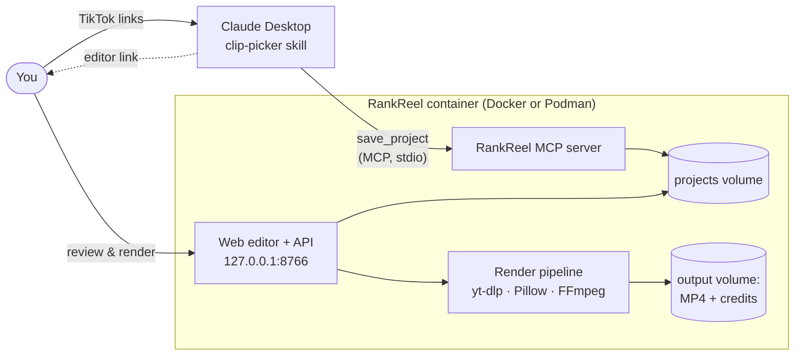

# RankReel

**An AI-powered tool for creating viral content for faceless channels.** Claude analyzes what's trending, pulls the source videos, watches them, picks the moments most likely to go viral, and assembles a ranked-clip YouTube Short. The creator only reviews the draft and clicks Render.

The output is the "ranking" format popular with faceless Shorts channels: a big title with colored words, a 1–N rank list that fills in as each clip plays, the most eye-catching clip as the opening hook, and #1 saved for last. Each render is a ready-to-upload 1080×1920 MP4 plus a credits file for the description.

## Why it matters — business impact

Ranking Shorts are a proven format for faceless channels, but making one is slow, manual
editing: find 5–7 source videos, scrub each for the 3–7 seconds worth keeping, decide the
order, then build the title, rank list and transitions by hand. That labour limits how many
videos a channel can publish, and on Shorts, publishing volume drives growth.

| Before | With RankReel | Effect |
|---|---|---|
| A person scrubs every clip by eye to find the moment | Claude "watches" each video through frame contact sheets and an audio-loudness timeline, then cuts to 0.1s | The slowest step is automated |
| Ordering clips is guesswork | Retention rules are encoded: hook first, best payoff last | Every video starts from a consistent, retention-aware structure |
| Titles, rank list, transitions, credits all built by hand | Generated as a draft project, rendered to a 1080×1920 MP4 plus a credits file | Ready to upload, with attribution included |
| An agent that can publish is a liability | The MCP server **cannot render, delete or publish**; a human approves every reel | Automation without losing editorial control |

The operator's job shrinks from editing to reviewing, so one person can run more channels
or post more often.

## The workflow

1. **Analyze trends.** Claude studies what's performing in the niche (competitor channels, outlier videos, title patterns) using the companion competitor-to-reel-kit skill with VidIQ. It turns that into a video idea, titles and a clip-hunting guide.
2. **Pull the videos.** Paste the TikTok links that match the idea. Claude downloads each one through RankReel's cache.
3. **Analyze the footage.** For every video, Claude reads frame contact sheets (every 0.5s, then 0.2s zooms around each cut) and an audio-loudness timeline that catches screams, laughs and impacts. It skips dead air, intros and title cards.
4. **Pick and rank.** It cuts 3–7s clips to 0.1s precision and applies proven retention rules: the most eye-catching clip is ranked #2 and opens the video, the best payoff is #1 and closes it, and the middle is shuffled. It also writes punchy on-screen names and a colored title.
5. **Save a draft.** Claude saves the project straight into RankReel through its MCP connector and replies with a link that opens it in the editor.
6. **Review and render.** You check the trims in the editor and render. A human signs off on every video, because Claude can't publish or render on its own.

Steps 2–6 are in this repo. Step 1 uses a separate skill.

## How it works



| Piece | What it does |
|---|---|
| **Clip-picker skill** ([`.claude/skills/rankreel-clip-picker`](.claude/skills/rankreel-clip-picker/SKILL.md)) | Downloads each video and builds frame contact sheets and an audio-loudness timeline so Claude can actually "watch" it. It cuts clips to 0.1s precision and applies the ranking rules: the most eye-catching clip is #2 and opens the video, the best payoff is #1 and closes it, and the rest are shuffled. |
| **MCP server** ([`rankreel/app/mcp_server.py`](rankreel/app/mcp_server.py)) | Lets Claude save, check, list and read draft projects in the running app. It runs inside the container, so drafts land where the app reads them. It deliberately can't render or delete: a human reviews every reel. |
| **Web editor** ([`rankreel/static`](rankreel/static)) | Edit the title colors, trims, ranks, playback order, transitions and sounds, with a live phone-frame preview and a duration check (sweet spot 27–35s, warning over 40s). |
| **Render pipeline** ([`rankreel/app`](rankreel/app)) | FastAPI backend. yt-dlp downloads and caches clips, Pillow draws the overlays, and FFmpeg composes an H.264/AAC MP4 plus `credits.txt`. |

## Quick start

You need Docker (or Podman). Everything else, including FFmpeg, is inside the image.

```bash
docker compose up -d --build
```

Open **http://127.0.0.1:8766**. The app only listens on this computer, and your projects, downloads, renders and sounds persist in named volumes.

With Podman, see [Run with Podman](rankreel/README.md#run-with-podman). It's the same image and volumes.

## Connect Claude Desktop

Add this to Claude Desktop's config (**Settings → Developer → Edit Config**) and restart it:

```json
{
  "mcpServers": {
    "rankreel": {
      "command": "docker",
      "args": ["exec", "-i", "rankreel", "python", "-m", "app.mcp_server"]
    }
  }
}
```

(Use `"command": "podman"` with Podman.) Then paste some TikTok links and ask for a ranking. Claude saves the draft and replies with a link like `http://127.0.0.1:8766/?project=…` that opens it in the editor.

| Tool | Purpose |
|---|---|
| `save_project` | Validate and save a new draft (never overwrites). Returns the editor link. |
| `check_project` | Run the same checks without saving. |
| `list_projects` / `get_project` | Browse and read saved drafts. |
| `list_sounds` | Transition sounds a project can use. |

## Repository layout

```
compose.yaml          Docker Compose setup
Containerfile         Image for Docker and Podman (targets: runtime, test)
rankreel/             The app: FastAPI backend, web editor, CLI, tests
  app/                models · validation · downloader · overlay · compose · render jobs · MCP server
  static/             Web editor (vanilla JS)
  tests/              pytest + Node editor tests
.claude/skills/       The clip-picker skill Claude uses to choose and rank clips
```

## Tests

```bash
docker build -f Containerfile --target test -t rankreel-test . && docker run --rm rankreel-test
```

These run the full suite in a disposable container, including the real FFmpeg encodes, the editor tests and an MCP round trip.

**End-to-end, as Claude Desktop:** [`e2e/claude_desktop_e2e.py`](e2e/claude_desktop_e2e.py) starts the MCP server the way Claude Desktop does (`docker exec -i rankreel …`), gives Claude its tools and instructions, and sends real user prompts: "make this ranking and save it", then "open that draft, change the transition and a clip name, save a new draft". It checks the outcome in the running app: clips and timestamps, the hook-first and #1-last order, colored title, validation, a working editor link, and an untouched original.

```bash
python3 -m venv .venv-e2e && .venv-e2e/bin/pip install -r e2e/requirements.txt
export ANTHROPIC_API_KEY=...
.venv-e2e/bin/python e2e/claude_desktop_e2e.py           # live with Claude; add --keep to leave the drafts for a demo
.venv-e2e/bin/python e2e/claude_desktop_e2e.py --offline # same checks, no Claude (replays the expected tool calls)
```

## More

The full user guide is in [rankreel/README.md](rankreel/README.md): using the editor, project JSON format, CLI, transition sounds, cookies for login-only links, and copyright notes.
